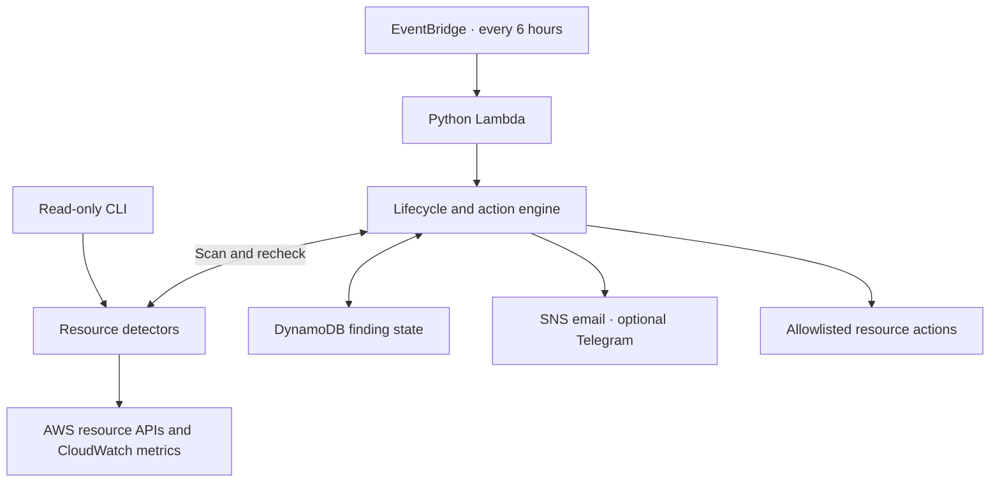

# Bill Shock Guard

Bill Shock Guard finds idle and unattached AWS resources, shows the evidence behind each finding, and estimates its monthly cost. I built it after seeing classmates leave lab infrastructure running and get bills they hadn’t budgeted for.

Run the read-only Python CLI for an on-demand audit, or deploy scheduled scans, email digests, and optional remediation with Terraform.

## Try the CLI

Use Python 3.12 or newer and AWS credentials with read access to the account. Run these commands from the repository root.

```bash
python -m pip install .
bsg doctor --regions us-east-1
bsg explain ec2_instance
bsg scan --regions us-east-1
bsg scan --regions us-east-1 --format json
```

Omit `--regions` to scan all enabled regions. The CLI is read-only. Use JSON output to see the proposed action for each finding.

This JSON excerpt shows one unattached Elastic IP in a mocked AWS account.

```json
{
  "resource_type": "elastic_ip",
  "resource_id": "eipalloc-708208323c7bca27a",
  "region": "us-east-1",
  "reason": "Elastic IP 127.206.32.53 (eipalloc-708208323c7bca27a) is unassociated",
  "est_monthly_cost_usd": 3.65,
  "cost_confidence": "estimate",
  "proposed_action": "eip_release",
  "protected": false
}
```

Estimates come from a bundled pricing table. The full scan includes the detection evidence and any scan warnings. See the [cost model and deployment cost assumptions](docs/COSTS.md).

## What it detects

| AWS resource | Idle or waste signal |
| --- | --- |
| EC2 instances | Low CPU and network activity over 24 hours by default |
| Elastic IPs | An allocated address with no association |
| NAT gateways | Zero outbound traffic over the observation window |
| EBS volumes | An unattached volume that meets the seven-day age threshold by default |
| Application and Network Load Balancers | No traffic or no registered targets |
| RDS instances | An eligible standalone instance with zero database connections over the observation window |
| SageMaker notebook instances | Low CPU utilization when CloudWatch metrics are available |

Use `bsg explain <resource_type>` to inspect the thresholds and proposed action for a resource type.

## Architecture and safety



- **Warn before acting.** The runner verifies a confirmed SNS email subscription, publishes an active-mode warning, and records it in DynamoDB before starting the default 24-hour grace period. SNS acknowledges the publish at the topic level. A finding previously warned in dry-run mode gets a fresh warning before it can be acted on.
- **Recheck before acting.** The detector fetches fresh resource state, tags, and relevant metrics. A resource that becomes active or gains a `bsg:keep=true` tag is skipped. An inconclusive recheck also blocks action. Terraform adds a tag-based IAM deny for the mapped actions.
- **Limit what can change.** Terraform defaults to `dry_run = true`. If you turn dry run off, the default allowlist permits EC2 stops and Elastic IP releases, with a cap of five action attempts per run. Terraform derives the IAM action grants from the same allowlist. EBS deletion requires explicit enablement and a completed snapshot.
- **Isolate scan failures.** The runner preserves findings from incomplete or unscanned regions and detectors. A CloudWatch alarm reports scan errors even when the Lambda invocation returns normally.

The state machine evaluates findings without AWS calls. The runner handles notifications, state writes, and resource actions. It uses a conditional DynamoDB write to claim each action before calling AWS. An uncertain outcome leaves the claim pending for operator reconciliation. See the [state machine](src/bill_shock_guard/engine/state_machine.py), [runner](src/bill_shock_guard/engine/runner.py), [architecture](docs/ARCHITECTURE.md), and [safety invariants](docs/SAFETY.md).

## Deploy scheduled scans

Use Terraform 1.6 or newer and AWS credentials that can provision the stack. From the repository root, package the Lambda and initialize the [basic example](terraform/examples/basic).

```bash
python scripts/package_lambda.py
terraform -chdir=terraform/examples/basic init
```

Create `terraform/examples/basic/terraform.tfvars` with your email address. This example uses an empty action allowlist to omit workload mutation grants from the Lambda role during the trial.

```hcl
aws_region          = "us-east-1"
notification_emails = ["you@example.com"]
dry_run             = true
enabled_actions     = []
```

```bash
terraform -chdir=terraform/examples/basic plan
terraform -chdir=terraform/examples/basic apply
```

Confirm the SNS subscription email after applying. The stack scans enabled regions every six hours by default. When finished, remove the example stack with `terraform -chdir=terraform/examples/basic destroy`. The [AWS verification guide](docs/VERIFICATION.md) covers manual invocation, an idle test resource, and exemption tagging.

## Testing and verification

A local run passed **414 tests** with **96% Python statement coverage**. The run blocked outbound AWS requests.

```bash
python -m pip install ".[dev]"
python -m pytest --cov=bill_shock_guard --cov-report=term-missing
```

- The grace period, dry-run behavior, and action limits are exercised across generated inputs in the [Hypothesis tests](tests/engine/test_state_machine.py).
- A simulated EC2 instance goes through warning, waiting, and remediation in the [Moto-backed lifecycle test](tests/engine/test_end_to_end.py). Pagination, partial regional failures, and malformed inputs are covered by the [adversarial tests](tests/adversarial).
- An automated test checks AWS SDK calls against the Terraform policy definitions. GitHub Actions runs Python linting, type checks, tests with coverage, Terraform validation, TFLint, and Checkov. See the [IAM drift test](tests/test_iam_matches_code.py) and [CI workflow](.github/workflows/ci.yml).

Live AWS validation is pending. See the [engineering notes](docs/ENGINEERING_NOTES.md) for the failure modes that shaped the safeguards.

## Author and license

Built by Tanishq Ingawale. Released under the [MIT License](LICENSE).
