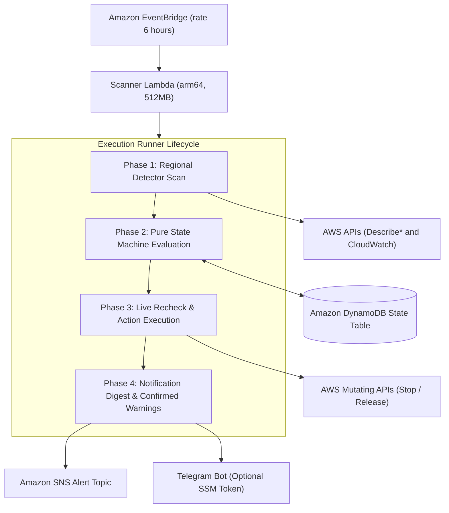
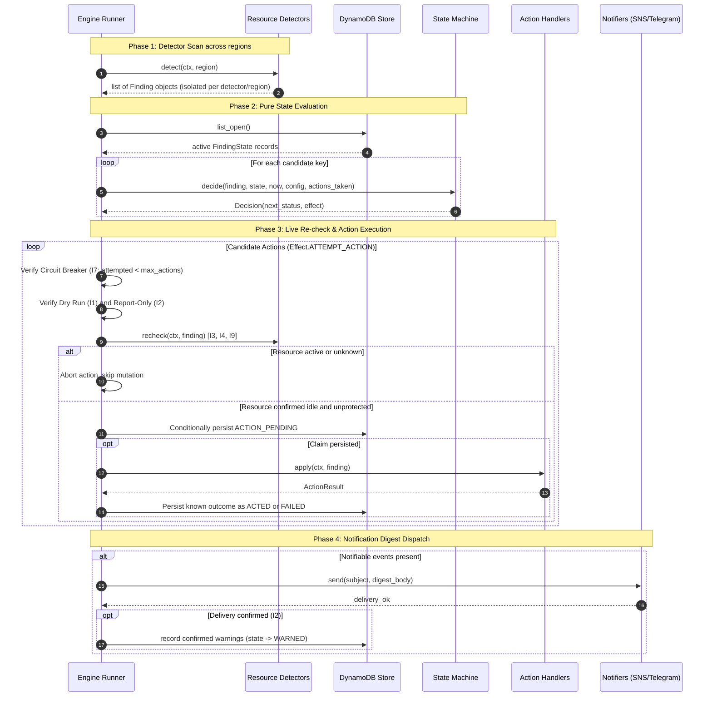
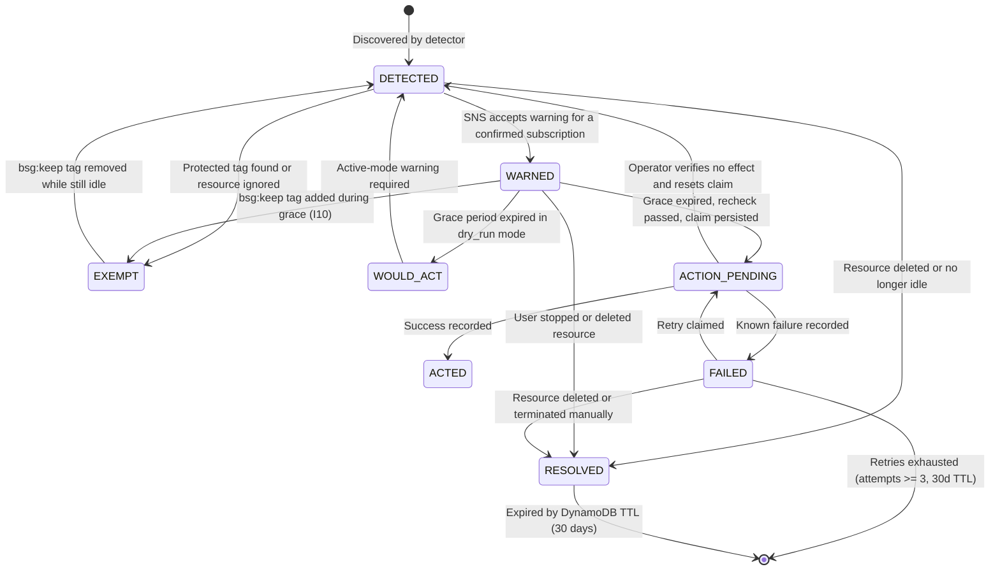

# Architecture and Component Design

Author: Tanishq Ingawale (MIT License)

Bill Shock Guard is designed as a modular, scheduled AWS governance utility. It prioritizes predictable behavior, transparent cost modeling, and safe failure containment over complex orchestration.

---

## 1. High-Level Architecture

The system consists of five primary layers:
1. **Trigger and Scheduling**: Amazon EventBridge schedules execution every 6 hours by invoking an AWS Lambda function (`python3.12`, `arm64`, 512 MB).
2. **Resource Detectors**: Individual detector plugins query AWS APIs across enabled regions to identify idle compute, storage, and networking resources.
3. **Pure State Machine**: A stateless transition engine (`decide()`) maps detected findings and past history into state transitions without making external API calls.
4. **Execution Runner**: Orchestrates the multi-region scan lifecycle, conducts live re-verification (Invariants I3, I4, I9), enforces circuit breaking (I7), and coordinates action execution.
5. **Notification and Persistence**: A composite notifier formats a single plain-text digest delivered through Amazon SNS and optional Telegram webhooks. State tracking is stored in an Amazon DynamoDB table using On-Demand capacity.

---

## 2. The 4-Phase Scanner Execution Lifecycle

The execution lifecycle in `src/bill_shock_guard/engine/runner.py` is divided into four sequential phases to guarantee error containment and satisfy safety invariants.

### Phase Details

1. **Phase 1: Regional Detector Scan (Error Isolation)**:
   - Queries `ec2:DescribeRegions` to discover active regions. On failure, scans explicitly configured regions if available and reports the discovery error.
   - Iterates through registered detectors (`EC2Detector`, `EIPDetector`, `NatGatewayDetector`, `EBSDetector`, `LoadBalancerDetector`, `RDSDetector`, `SageMakerNotebookDetector`).
   - Each detector runs in isolation and can report incomplete coverage. The runner records which detector and region combinations completed successfully.

2. **Phase 2: Pure State Evaluation and Transitions**:
   - Loads all open records from the DynamoDB state table using `list_open()`.
   - Compares current scan findings with prior persisted states using the composite key `region#resource_type#resource_id`.
   - The runner resolves missing findings only when their detector completed successfully in their region.
   - Invokes the pure function `decide()`. Findings ready for warning are queued into `new_warnings_to_deliver`; findings past their grace period are queued into `candidate_actions`.

3. **Phase 3: Live Re-Check and Action Execution**:
   - Defers remaining actions once the number of action handler calls reaches `max_actions_per_run`.
   - Validates `dry_run`: if `true`, updates finding status to `WOULD_ACT` and never calls mutating APIs (Invariant I1).
   - Validates `sns_topic_arn`: if unconfigured, enforces report-only mode (Invariant I2).
   - Performs a fresh, live re-check of the target resource (`detector.recheck()`). CloudWatch activity metrics, resource existence, and protection tags are evaluated in real time (Invariants I3, I4, I9).
   - If the resource remains idle and unprotected, the runner must persist `ACTION_PENDING` before executing the action. Known outcomes become `ACTED` or `FAILED`. Uncertain outcomes stay pending for operator reconciliation.

4. **Phase 4: Notification Digest Dispatch and Confirmed Warning Recording**:
   - Sends new warnings and action counts through Amazon SNS and optional Telegram. The Lambda logs run errors separately for the scan-errors alarm.
   - After confirming an SNS email subscription and receiving an SNS publish acknowledgment, the runner persists `WARNED` with the acknowledgment time and grace deadline. A warning must cover the current action and topic in active mode before it can authorize an action.

---

## 3. State Machine Transitions

The lifecycle of every tracked resource is governed by a deterministic state machine:

### Transition States Reference

| State | Definition |
|---|---|
| `DETECTED` | Initial discovery. Resource is idle, but warning digest has not yet been confirmed. |
| `WARNED` | SNS accepted the warning and the runner recorded the grace deadline. |
| `EXEMPT` | Resource is tagged with `bsg:keep`, belongs to an ignored list, or is system-managed. |
| `WOULD_ACT` | Grace period has expired, but scanner is operating in dry run mode (`dry_run = true`). |
| `ACTION_PENDING` | An action was claimed. An unresolved claim stays pending for operator reconciliation. |
| `ACTED` | Remedial action (`ec2_stop`, `eip_release`, etc.) executed successfully. |
| `FAILED` | The action returned a known failure. The runner allows up to three total attempts. |
| `RESOLVED` | Resource was deleted, stopped by the user, or acquired active workload traffic. |

---

## 4. DynamoDB Schema Rationale

The state table is defined in `terraform/modules/guard/state.tf` with the following design choices:

- **Partition Key (`key`, String)**:
  - Formatted as `region#resource_type#resource_id` (e.g. `us-east-1#ec2_instance#i-0123456789abcdef0`).
  - *Rationale*: Guarantees unique partition keys across AWS regions even if identical resource IDs exist in separate regions. Allows single-item lookups via `GetItem`.
- **Concurrency Control (`version`, Number)**:
  - Updates require conditional writes: `attribute_not_exists(key)` on initial insert, and `version = :expected_version` on subsequent state modifications.
  - *Rationale*: Eliminates race conditions or lost updates if manual invocations or concurrent executions occur.
- **Automatic Cleanup (`ttl`, Number)**:
  - Configured with attribute name `ttl` (epoch timestamp in seconds).
  - Terminal states (`RESOLVED`, `EXEMPT`, `ACTED`, abandoned `FAILED`) set `ttl = now + 30 days`.
  - *Rationale*: Old findings are automatically purged by DynamoDB without recurring maintenance scripts, keeping storage volume minimal (< 2 MB).
- **Billing Mode (`PAY_PER_REQUEST`)**:
  - Uses DynamoDB On-Demand capacity.
  - *Rationale*: Periodic 6-hour scans generate small request bursts followed by hours of zero activity. On-Demand pricing costs less than $0.0001 per month, avoiding provisioned capacity charges.

---

## 5. Lambda Packaging Rationale

The scanner Lambda is designed to run with minimal deployment complexity:

- **Zero External Runtime Dependencies**:
  - Uses only standard library modules and AWS SDK libraries (`boto3`, `botocore`) pre-installed in the official AWS Lambda Python 3.12 runtime environment.
  - *Rationale*: Eliminates the need for Lambda layers, container registries, or `pip install` build steps during deployment. Students can inspect, zip, and deploy the source code directly.
- **Architecture and Memory**:
  - Architecture: `arm64` (AWS Graviton2).
  - Memory: 512 MB.
  - *Rationale*: Graviton2 provides faster execution at a 20% lower unit rate ($0.0000133334/GB-s). 512 MB ensures fast Python module import and ample network buffer space when querying multiple regional endpoints concurrently.
- **Reserved Concurrency (`reserved_concurrent_executions = 1`)**:
  - Concurrency is capped strictly at 1.
  - *Rationale*: Prevents concurrent execution runs from overlapping or exhausting API rate limits.
